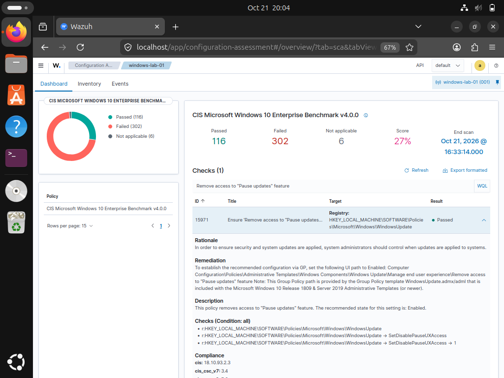
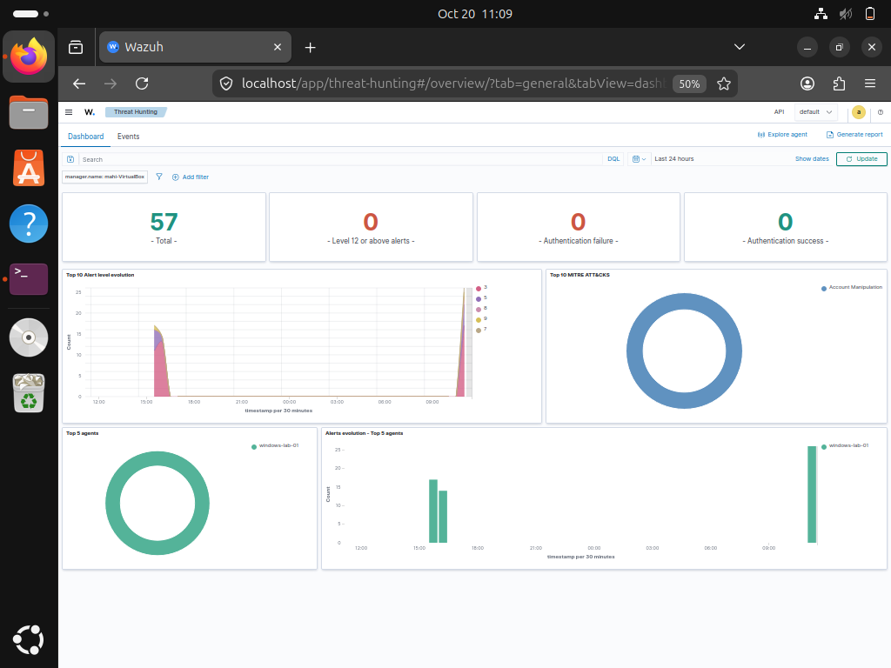
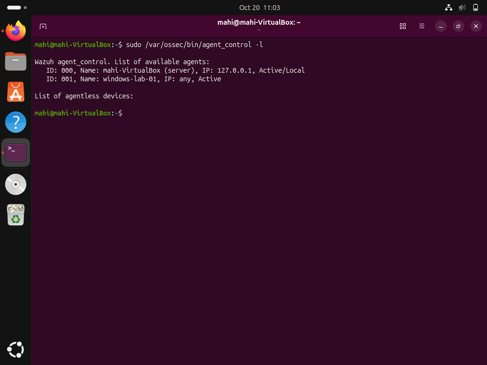
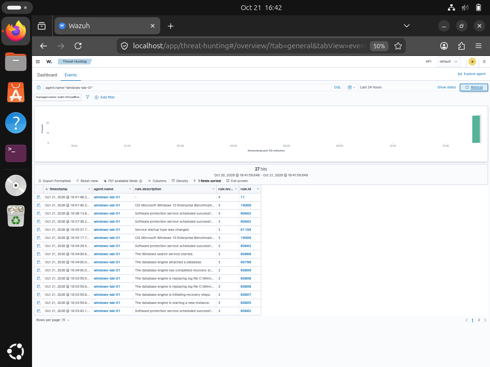
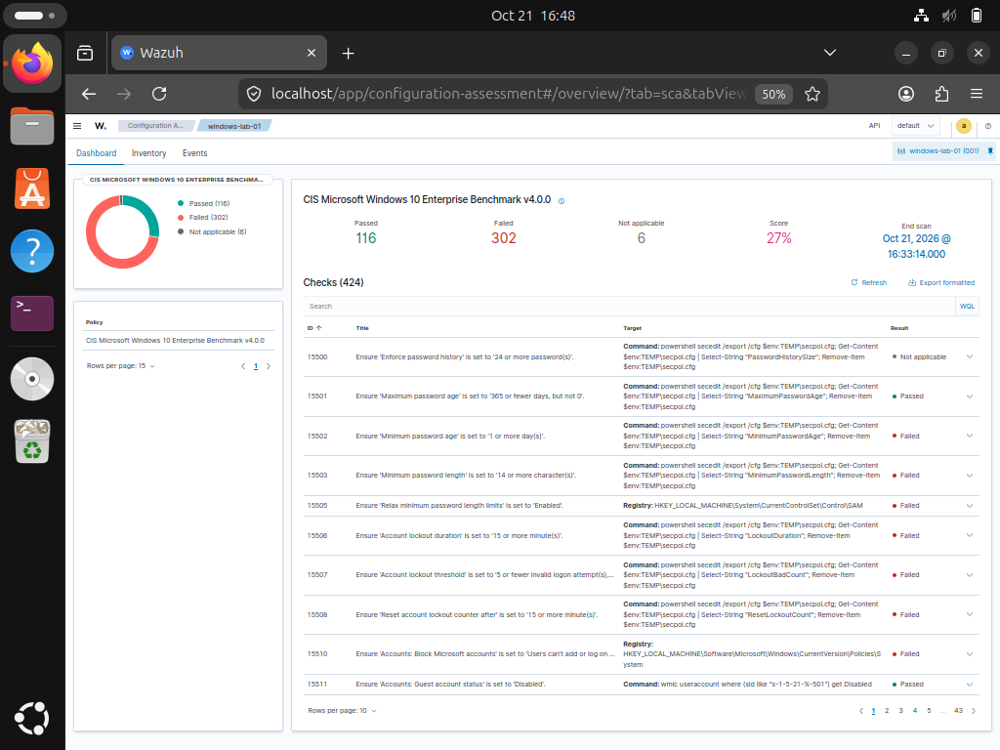

# Home SIEM Lab — Wazuh

A hands-on Security Operations Center (SOC) home lab built using Wazuh, Ubuntu Server, Windows 10, and VirtualBox. This project demonstrates endpoint monitoring, security event investigation, and Windows security configuration assessment.

## Project Objectives

- Deploy a Wazuh SIEM environment.
- Connect a Windows endpoint to the Wazuh manager.
- Monitor and investigate Windows security events.
- Investigate failed logon events.
- Assess Windows security configuration using Security Configuration Assessment (SCA).
- Remediate a security configuration finding and verify the result.

## Lab Environment

| Component | Details |
|---|---|
| Host OS | Arch Linux |
| Virtualization | Oracle VirtualBox |
| SIEM | Wazuh 4.14.8 |
| SIEM Server | Ubuntu 26.04 LTS |
| Endpoint | Windows 10 Pro |
| Wazuh Agent | `windows-lab-01` |
| Lab Network | VirtualBox NAT Network |

## Work Completed

### 1. Wazuh Deployment

Deployed the Wazuh all-in-one environment and accessed the Wazuh dashboard.

### 2. Windows Endpoint Integration

Installed and configured the Wazuh agent on Windows. Verified that the endpoint appeared as active in the Wazuh manager.

### 3. Failed Logon Investigation

Investigated Windows Security Event ID `4625` (failed logon) in Wazuh Threat Hunting. The event was associated with Wazuh rule ID `60122`.

The available event details did not establish the exact cause, so this finding is documented as an observed failed-logon event rather than a confirmed attack.

### 4. Windows Security Configuration Assessment

Used Wazuh SCA to assess the Windows endpoint against the CIS Microsoft Windows 10 Enterprise Benchmark.

Remediated the policy setting **Remove access to "Pause updates" feature** by enabling it through Group Policy, then refreshed the assessment and verified that the check changed from Failed to Passed.

### 5. Verified CIS Remediation

Enabled the Windows Group Policy setting to remove access to the "Pause updates" feature. A subsequent Wazuh assessment reported the check as **Passed**.

## Investigation Notes

Windows PowerShell Operational log collection was configured, but the expected PowerShell events were not confirmed in Wazuh Threat Hunting during testing. This remains an area for further troubleshooting.

## Skills Practiced

- SIEM deployment and administration
- Windows endpoint monitoring
- Wazuh agent configuration and validation
- Security event investigation
- Windows Event ID analysis
- Security Configuration Assessment
- CIS benchmark remediation
- Basic security documentation and evidence collection

## Lab Architecture

The lab uses an Ubuntu server running Wazuh and a Windows 10 endpoint connected through a VirtualBox NAT Network.

## Lab Evidence

### 1. Wazuh Dashboard

Overview of the Wazuh SIEM dashboard.

### 2. Windows Agent Status

The Wazuh manager reports `windows-lab-01` as Active.

### 3. Windows Event Monitoring

Windows endpoint events displayed in Wazuh Threat Hunting.

### 4. CIS Security Assessment

Wazuh assessment results for the Windows endpoint using the CIS Microsoft Windows 10 Enterprise Benchmark v4.0.0.

## Disclaimer

This project was conducted in a personal virtual lab for educational purposes. The events and findings documented here are lab observations and should not be interpreted as evidence of a real-world compromise.
